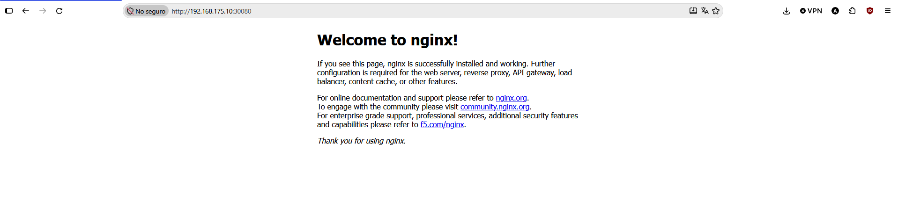
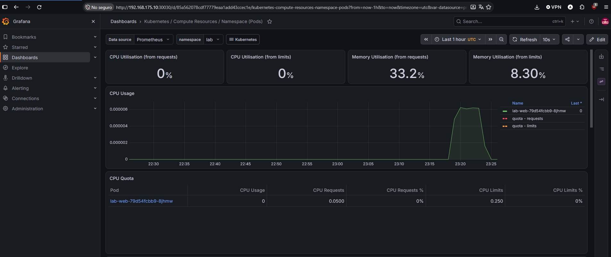
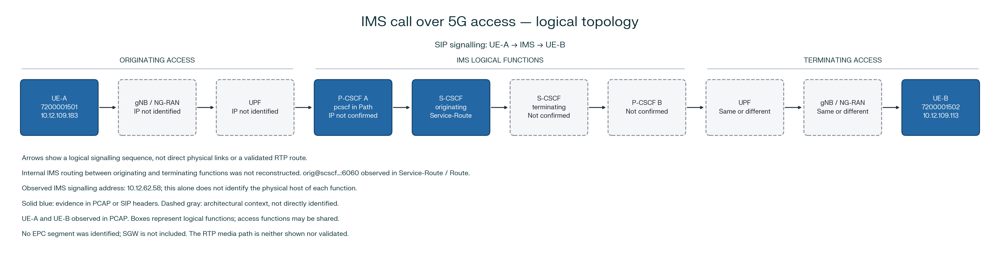
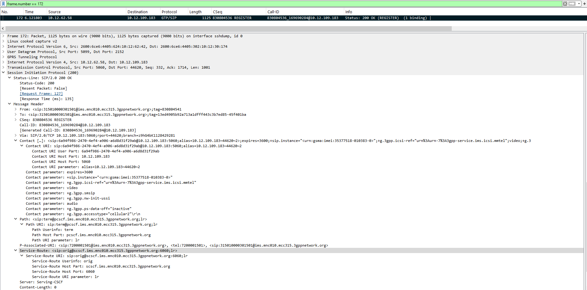
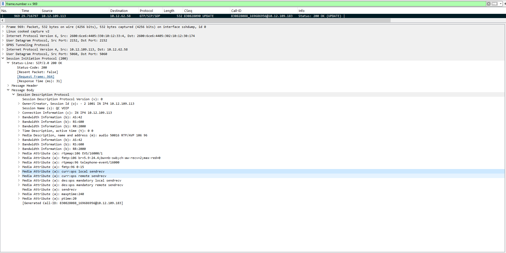
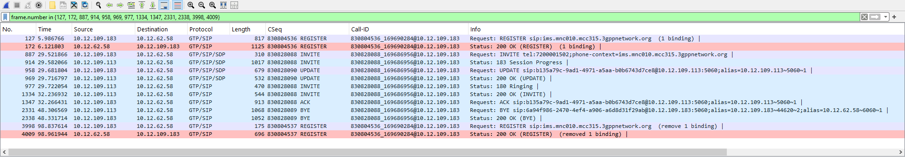

# Deployment Engineer Technical Case Study

Language: [Español](README.md) | English

Candidate: Agustin Villarauz  
Lab started: November 4, 2026  
Status: lab implementation and PCAP analysis documented. NGINX, Grafana, and Wireshark screenshots included. Known verification and reproducibility limits are stated below.

## 1. Objective and Scope

This case study documents three tasks:

1. Build a Kubernetes cluster.
2. Deploy an application and validate access to it.
3. Analyze and explain a telecom packet capture using Wireshark.

Local virtual machines are permitted by the assignment. The infrastructure was therefore implemented locally using VMware and K3s.

The PCAP analysis is independent of the Kubernetes deployment. The capture was not generated by this cluster, and deploying an IMS platform was outside the scope of this implementation.

## 2. Environment and Architecture

### Host Environment

The reported host configuration is:

- Windows 10 Home, build 19045.
- Intel Core i9-9900K.
- 64 GB RAM.
- Two Samsung 970 EVO SSDs, each reporting approximately 932 GB of capacity. These figures describe capacity, not available free space.
- VMware Workstation Pro `26.0.1.25688693`.

Local infrastructure was selected to avoid reopening a billable cloud account.

The cluster consists of one K3s server and one agent. This configuration does not provide control-plane high availability.

### Node and Network Layout

| Node | Observed status | Internal IP | NAT IP | Private interface | Pod subnet |
|---|---|---|---|---|---|
| k3s-server-01 | Ready | 192.168.175.10 | 192.168.138.128 | ens34 | 10.42.0.0/24 |
| k3s-worker-01 | Ready | 192.168.175.11 | 192.168.138.131 | ens37 | 10.42.1.0/24 |

```text
Windows host / VMware Workstation Pro
├── VMnet8 NAT: 192.168.138.0/24 — gateway 192.168.138.2
│   ├── server ens33: 192.168.138.128
│   └── worker ens33: 192.168.138.131
└── VMnet1 host-only: 192.168.175.0/24
    ├── server ens34: 192.168.175.10
    └── worker ens37: 192.168.175.11
```

Both nodes were recorded as reporting:

- Ubuntu `24.04.5 LTS`.
- K3s `v1.37.2+k3s1`.
- Kernel `6.8.0-147-generic`.
- containerd `2.3.7-k3s1`.

These values were transcribed from the lab's terminal output; they have not been independently checked against upstream release records.

The default route uses `ens33` through the NAT network. The host-only interfaces have no default gateway.

The K3s `node-ip` and `flannel-iface` settings select the private node addresses and interfaces. Routes to remote pod subnets were observed through `flannel.1`. Route inspection alone was not treated as an active connectivity test.

## 3. K3s Deployment: Implementation Steps and Evidence

The lab was implemented using the following sequence:

1. Created two VMware virtual machines and installed Ubuntu on both.

2. Configured two network interfaces on each VM: a NAT interface for outbound connectivity and a host-only interface for private communication between the host and the nodes.

3. Assigned the private addresses `192.168.175.10` to the server and `192.168.175.11` to the worker. Kept the default route on the NAT interface, with no default gateway configured on the host-only interfaces.

4. Installed the K3s server on `k3s-server-01`, configuring its private node address and selecting its host-only interface for Flannel networking.

5. Installed the K3s agent on `k3s-worker-01` and joined it to the server, configuring the worker's private node address and host-only interface.

6. Verified that both nodes reported `Ready`, inspected their internal addresses, and reviewed the routes to the remote pod subnets. Route inspection was not treated as an active connectivity test.

7. Deployed the NGINX application and monitoring stack using the manifests and Helm configuration described in Section 4.

8. Inspected nodes, pods, services, persistent volume claims, and the monitoring Helm release using the validation commands in Section 5.

9. Accessed NGINX and Grafana from the Windows host browser through their NodePort services. Screenshots are included in Section 4.

### Implementation Record and Limitations

The sequence above summarizes the implementation performed. The exact historical K3s installation and agent-join commands were not recovered, so this section is not presented as a tested, clean-install runbook.

Reference configuration files document observed non-secret settings only; they do not constitute a complete automated installation procedure. No join token or kubeconfig is included in the submission.


## 4. NGINX Application and Monitoring

### 4.1. NGINX Application

The `lab-web` application uses the `nginx:stable-alpine` image and runs a single replica pinned to the worker node.

Its configured resource requests and limits are:

| Resource | Request | Limit |
|---|---|---|
| CPU | 50m | 250m |
| Memory | 32Mi | 128Mi |

The NodePort service exposes port `30080` and forwards traffic to HTTP port `80`. No explicit probes or application volumes are declared in the manifest.

The application was accessed from the Windows host browser at:

`http://192.168.175.10:30080`



### 4.2. Monitoring

The `monitoring` Helm release was observed as `deployed` at revision `2`, using chart `kube-prometheus-stack-93.1.1`.

The chart-reported App Version is `v0.95.1`; this does not represent the individual version of every component.

Grafana runs as a single replica on the server node, is exposed through NodePort `30030`, and uses a `1Gi` persistent volume claim (PVC).

Prometheus runs as a single replica on the worker node, uses a ClusterIP service and a `5Gi` PVC, and has scrape and evaluation intervals of 30 seconds. Retention is configured for 24 hours, with a size limit of `2GB`.

Both PVCs were observed as `Bound`, use the `ReadWriteOnce` (RWO) access mode, and use the `local-path` storage class.

Alertmanager is disabled. The chart's monitors for the controller manager, etcd, kube-proxy, and scheduler are disabled; this does not disable those cluster components.

Grafana was accessed from the Windows host browser at:

`http://192.168.175.10:30030`



### 4.3. Reconstructed Deployment Commands

The commands below reflect the documented configuration but were not retested as a clean installation. They are included as a reconstruction, not as an exact historical command log.

Run on the server after reviewing the referenced manifests:

```bash
sudo kubectl apply -f manifests/lab-web.yaml

helm repo add prometheus-community \
    https://prometheus-community.github.io/helm-charts

helm repo update

sudo helm --kubeconfig /etc/rancher/k3s/k3s.yaml \
  upgrade --install monitoring \
  prometheus-community/kube-prometheus-stack \
  --version 93.1.1 \
  --namespace monitoring \
  --create-namespace \
  -f manifests/monitoring-values.yaml
```

## 5. Validation and Access

The following commands were used to inspect the deployment:

```bash
sudo kubectl get nodes -o wide
sudo kubectl get pods -A -o wide
sudo kubectl get svc -A
sudo kubectl get pvc -A
sudo helm --kubeconfig /etc/rancher/k3s/k3s.yaml list -A
```

The documented observations were:

- Both nodes reported `Ready`.
- Pods in the `Running` phase showed all containers ready.
- Completed installation tasks remained visible.
- Historical restart counts were recorded without assigning an unverified cause.
- The temporary BusyBox pod `lab-netcheck`, which used `sleep 3600`, was removed.
- The `lab-web` pod remained `1/1 Running`.

Access from Windows after startup was confirmed without a tunnel, using the following NodePort addresses:

| Service | Address |
|---|---|
| NGINX | `http://192.168.175.10:30080` |
| Grafana | `http://192.168.175.10:30030` |

Screenshots of NGINX and Grafana access are included in Section 4. The scope of validation is limited to the observations documented here.

NGINX application metrics were not verified. The presence of the monitoring stack alone does not establish that an NGINX exporter is configured.

## 6. IMS / SIP Analysis over 5G Access

### 6.1. Capture Context and Scope

The capture was provided by a colleague as lab material. The recorded metadata identifies `sshdump` and a capture date of November 9, 2026.

Permission to share the capture-derived information included in this case study has been confirmed. The original PCAP is not included in the repository.

This analysis is independent of the Kubernetes deployment: the capture was not generated by this lab cluster.

The endpoints identified during the analysis are:

| Role | IP address | Telephone identity |
|---|---|---|
| UE-A | 10.12.109.183 | 7200001501 |
| UE-B | 10.12.109.113 | 7200001502 |

The observed IMS-facing signalling address is `10.12.62.58`. This address alone does not map each logical function to a physical server.

### 6.2. Analysis Procedure

The analysis followed this sequence:

1. Identify the registration exchange and inspect the requested and accepted binding lifetimes.
2. Review the associated identity and routing headers returned during registration.
3. Apply a Call-ID filter to isolate the selected call.
4. Compare the SDP offer and answer, including advertised codecs and receive addresses.
5. Follow the provisional response and QoS precondition updates.
6. Locate ringing, final call acceptance, acknowledgement, and call release messages.
7. Identify registration binding removal messages.
8. Document the limitations rather than treating signalling observations as proof of media performance or security establishment.

### 6.3. Logical Topology



Boxes represent logical functions, not necessarily separate physical servers. The diagram distinguishes evidence observed in the PCAP or SIP headers from elements included as architectural context.

```text
UE-A -> gNB-A* -> UPF-A* -> P-CSCF-A -> originating S-CSCF
  -> [IMS internal routing not reconstructed]
  -> terminating S-CSCF* -> P-CSCF-B* -> UPF-B* -> gNB-B* -> UE-B
```

An asterisk (*) identifies a function included as architectural context rather than directly identified.

The `pcscf` and originating `scscf` names appear in SIP headers, but they have not been mapped to specific physical servers. The two access paths may share network functions.

The gNB and UPF roles are included as architectural context; their addresses were not identified. No EPC/SGW segment was identified in the analysis.

Arrows represent a logical signalling sequence, not direct physical connections or a validated RTP media path.

### 6.4. Registration and Routing

The REGISTER request in frame `127` requests a registration lifetime of `600000` seconds. Its response in frame `172` returns a `Contact` field with `expires=3600`.

The response includes:

- `P-Associated-URI` containing the identity `7200001501`.
- `Path` containing the name `pcscf`.
- `Service-Route` containing `orig@scscf:6060`.

The later INVITE uses that identity and route.

The `Path` information preserves a route towards the registered contact, while `Service-Route` informs routing for requests originating from the terminal.

#### Registration Evidence



The screenshot shows the response to REGISTER in frame 172 and the headers used to analyze the registration lifetime, associated identity, and routing.

### 6.5. SDP and Preconditions

UE-A offers EVS, AMR-WB, AMR, and telephone events, advertising reception at `10.12.109.183:50030`.

UE-B retains EVS and `telephone-event`, advertising reception at `10.12.109.113:50016`.

These are SDP observations, not validation that media flowed successfully between those addresses.

The `183 Session Progress` response requires `100rel` and `precondition` and includes `RSeq: 1`. Exact correlation with the PRACK `RAck` header was not checked.

The observed precondition sequence is:

1. The initial current local and remote QoS states are `none`.
2. UE-B requires QoS in both directions at both ends and requests remote confirmation.
3. The UPDATE in frame `958` reports local `sendrecv` and remote `none` from UE-A's perspective.
4. The `200 OK` response to UPDATE in frame `969` reports both local and remote states as `sendrecv` from UE-B's perspective.
5. This is followed by `180 Ringing`, the final `200 OK` response to INVITE, ACK, and the BYE/200 release exchange.

The `200 OK` response to UPDATE acknowledges that UPDATE transaction; it is not the final acceptance of the INVITE.

#### QoS Preconditions Evidence



The screenshot shows the SDP of the response to UPDATE in frame 969, with the current local and remote QoS states set to `sendrecv` from UE-B's perspective. This documents the state advertised in signalling, not a validation of RTP traffic.

### 6.6. Demonstration Packets

Frame numbers refer to the analyzed capture.

| Frame | Message / focus |
|---|---|
| 127 | REGISTER; IPv6 / UDP / GTP-U / IPv4 / TCP / SIP; QFI 1 |
| 172 | 200 OK to REGISTER; Contact expires=3600; associated identities and routes |
| 887 | INVITE; initial SDP offer |
| 914 | 183 Session Progress; EVS and telephone-event; 100rel; preconditions |
| 958 | UPDATE; local QoS state becomes sendrecv |
| 969 | 200 OK to UPDATE; local and remote QoS states sendrecv |
| 977 | 180 Ringing |
| 1334, 1347 | 200 OK to INVITE and ACK |
| 2331, 2338 | BYE and 200 OK to BYE |
| 3998, 4009 | Registration binding removal request and acceptance |

Wireshark display filter for the selected call:

```text
sip.Call-ID == "830828088_169686956@10.12.109.183"
```

Selected-frame display filter, including registration and call messages:

```text
frame.number in {127, 172, 887, 914, 958, 969, 977, 1334, 1347, 2331, 2338, 3998, 4009}
```

#### Overview of Selected Messages



The filtered list brings together the selected registration and call messages, allowing the sequence described in the preceding table to be followed. It shows selected packets, not every message in the capture.

### 6.7. Findings and Analysis Limits

The selected signalling sequence documents registration, SDP negotiation, QoS precondition state changes, ringing, call acceptance, and release.

The following limits apply:

- RTP delivery, packet loss, jitter, playback, and subsequent codec changes were not validated.
- A complete IMS-AKA authentication exchange was not observed.
- `Security-Client` proposals do not prove that IPsec was established.
- The selected REGISTER has no visible ESP; this observation is not generalized to the entire capture or network.
- QFI is not the same identifier as 5QI.
- Repeated observations are not automatically classified as retransmissions.
- Call-release and registration-removal messages were identified in the packet list, but their full headers were not inspected.

## 7. Limitations and Improvements

| Area | Current limitation | Potential improvement |
|---|---|---|
| Availability | One server node and one physical host; no high availability | Evaluate a multi-server deployment across separate failure domains |
| Application resilience | One NGINX replica with fixed placement | Review replica count and scheduling constraints |
| Application configuration | Mutable image tag and no explicit probes | Pin the image and define appropriate probes |
| Persistence | Local storage without tested backup and restore | Document and test recovery procedures |
| Transport security | Lab HTTP access without validated TLS or hardening | Add and validate appropriate security controls |
| Recovery testing | Post-startup access was checked, but comprehensive failure recovery was not | Define and execute recovery test cases |
| Reproducibility | Historical installation commands and final VM allocations were not fully recorded | Capture a tested installation runbook and final resource settings |

The host's support and security status was not assessed.

## 8. Optional Cleanup — Destructive

Do not perform cleanup during the demonstration.

The following command deletes resources defined in the application manifest:

```bash
sudo kubectl delete -f manifests/lab-web.yaml
```

The manifest also defines a namespace. Deleting that namespace may affect other resources within it.

Before uninstalling monitoring, review stored data, PVCs, and retention policies. No automatic volume deletion is proposed.

Preserve required evidence and backups before removing lab resources.


## Technical References

- RFC 3261 — SIP.
- RFC 3264 — SDP Offer/Answer Model.
- RFC 3262 — Reliability of Provisional Responses in SIP.
- RFC 3311 — SIP UPDATE Method.
- RFC 3312 — Integration of Resource Management and SIP Preconditions.
- RFC 3327 — SIP Path Header Field.
- RFC 3608 — SIP Service-Route Header Field.
- RFC 7315 — SIP Private Header Extensions.
