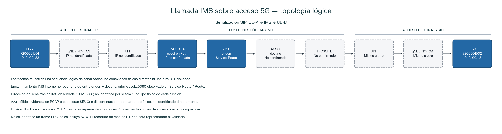

# Caso técnico de Deployment Engineer

Idioma: Español | [English](README.en.md)

Candidato: Agustin Villarauz. Inicio del laboratorio: 4 de noviembre de 2026.
Estado: borrador verificado parcialmente, pendiente de capturas y revisión final.

## 1. Objetivo y alcance

Construir un clúster Kubernetes, desplegar una aplicación y explicar un caso telecom en Wireshark. Se utiliza un laboratorio local de VM, permitido por el reto. 

## 2. Entorno y arquitectura

Host reportado: Windows 10 Home build 19045,
                 Intel Core i9-9900K, 64 GB RAM,
                 VMware Workstation Pro 26.0.1.25688693.

Se eligió infraestructura local para evitar cobros en este demo.
El diseño tiene un servidor K3s y un agente; no ofrece alta disponibilidad.

| Node | Status | Internal IP | NAT IP | Private interface | Pod subnet |
|---|---|---|---|---|---|
| k3s-server-01 | Ready | 192.168.175.10 | 192.168.138.128 | ens34 | 10.42.0.0/24 |
| k3s-worker-01 | Ready | 192.168.175.11 | 192.168.138.131 | ens37 | 10.42.1.0/24 |

```text
Windows host / VMware Workstation Pro
├── VMnet8 NAT: 192.168.138.0/24 — gateway 192.168.138.2
│   ├── server ens33: 192.168.138.128
│   └── worker ens33: 192.168.138.131
└── VMnet1 host-only: 192.168.175.0/24
    ├── server ens34: 192.168.175.10
    └── worker ens37: 192.168.175.11
```

Ambos nodos reportan Ubuntu 24.04.5 LTS, K3s `v1.37.2+k3s1`, kernel `6.8.0-147-generic` y containerd `2.3.7-k3s1`. Son valores transcritos de la terminal, no una validación independiente de publicaciones upstream.

La ruta por defecto utiliza ens33/NAT. La red host-only no tiene gateway por defecto. K3s fija node-ip y flannel-iface a las interfaces privadas correspondientes. Las rutas muestran comunicación hacia la subred remota mediante flannel.1; esta observación no sustituye un test activo de conectividad.

## 3. Despliegue de K3s: evidencia y reconstrucción

Se instalaron dos VM y se incorporó el agente al servidor. Los comandos históricos exactos de instalación no se recuperaron; no se inventa un registro literal. Los archivos `manifests/k3s-*.reference.yaml` contienen únicamente parámetros no secretos observados, no una instalación completa.

El diseño original proponía 2 vCPU, 4 GB RAM y 40 GB de disco por VM. La asignación final de hardware y el checksum del ISO siguen pendientes de comprobar y no se presentan como evidencia confirmada.

Para repetir el montaje: crear las dos VM, verificar sus recursos e interfaces, configurar NAT y host-only, instalar una versión K3s disponible y validada, configurar la IP y la interfaz privada, y unir el agente mediante un token gestionado fuera del repositorio. No se incluyen tokens ni kubeconfig. Antes de ejecutar comandos de instalación debe cerrarse esa sección con el registro real o una reconstrucción probada.

## 4. Aplicación NGINX y monitorización

### 4.1. Aplicación NGINX

`lab-web` usa `nginx:stable-alpine`, con una réplica seleccionada en el worker. Solicita 50m CPU y 32Mi RAM; tiene límites de 250m CPU y 128Mi RAM. El servicio NodePort publica el puerto 30080 hacia el puerto HTTP 80. El manifiesto no declara probes ni volúmenes de aplicación.

La aplicación se consultó desde el navegador del host mediante:
`http://192.168.175.10:30080`.


### 4.2. Monitorización
El release `monitoring` está deployed, revisión 2, chart `kube-prometheus-stack-93.1.1`, App Version reportada `v0.95.1`. Esa App Version no es la versión individual de cada componente.

Grafana: servidor, una réplica, NodePort 30030, PVC 1Gi. Prometheus: worker, una réplica, ClusterIP, PVC 5Gi, scrape/evaluación 30s, retención 24h y límite por tamaño 2GB. Ambos PVC figuran Bound, RWO, local-path. Alertmanager está deshabilitado. Los monitores de controller manager, etcd, kube-proxy y scheduler están deshabilitados en el chart, no los componentes del clúster.

Grafana se consultó desde el navegador del host mediante
`http://192.168.175.10:30030`.


### Reconstrucción del despliegue de aplicación

Los siguientes comandos se proponen a partir de la configuración previa.

```bash
# Run on the server; review before executing.
sudo kubectl apply -f manifests/lab-web.yaml

helm repo add prometheus-community https://prometheus-community.github.io/helm-charts
helm repo update
sudo helm --kubeconfig /etc/rancher/k3s/k3s.yaml upgrade --install monitoring   prometheus-community/kube-prometheus-stack   --version 93.1.1 --namespace monitoring --create-namespace   -f manifests/monitoring-values.yaml
```

## 5. Validación y acceso

```bash
sudo kubectl get nodes -o wide
sudo kubectl get pods -A -o wide
sudo kubectl get svc -A
sudo kubectl get pvc -A
sudo helm --kubeconfig /etc/rancher/k3s/k3s.yaml list -A
```

Resultado observado: ambos nodos Ready; pods Running con todos sus contenedores preparados. Jobs de instalación Completed se conservan como tales. Hay reinicios históricos; no se atribuye una causa sin evidencia. Se retiró el pod temporal lab-netcheck (BusyBox 1.37, sleep 3600) y se comprobó que lab-web seguía 1/1 Running.

El candidato confirmó acceso desde Windows después del encendido a lab-web y Grafana sin túnel. Direcciones basadas en los NodePort observados:

- Aplicación: `http://192.168.175.10:30080`
- Grafana: `http://192.168.175.10:30030`

Pendiente de la comprobación final: repetir ambos accesos y guardar capturas. No se documenta una validación de métricas de aplicación NGINX: la presencia del stack no prueba que exista un exporter de NGINX configurado.

## 6. Análisis IMS / SIP sobre acceso 5G

### 6.1. Contexto y alcance de la captura

La captura fue facilitada por un compañero como material de laboratorio. Los metadatos registrados indican `sshdump` y una fecha de captura del 9 de noviembre de 2026.

Se ha confirmado la autorización para compartir la información derivada de la captura incluida en este caso técnico. El archivo PCAP original no se incluye en el repositorio.

Este análisis es independiente del despliegue de Kubernetes: la captura no fue generada por el clúster de este laboratorio.

Los extremos identificados durante el análisis son:

| Función | Dirección IP | Identidad telefónica |
|---|---|---|
| UE-A | 10.12.109.183 | 7200001501 |
| UE-B | 10.12.109.113 | 7200001502 |

La dirección de señalización orientada hacia IMS observada es `10.12.62.58`. Esta dirección no permite, por sí sola, asignar cada función lógica a un servidor físico.

### 6.2. Procedimiento de análisis

El análisis siguió esta secuencia:

1. Identificar el intercambio de registro e inspeccionar los tiempos de validez solicitados y aceptados.
2. Revisar la identidad asociada y las cabeceras de encaminamiento devueltas durante el registro.
3. Aplicar un filtro por Call-ID para aislar la llamada seleccionada.
4. Comparar la oferta y la respuesta SDP, incluidos los códecs y las direcciones de recepción anunciadas.
5. Seguir la respuesta provisional y las actualizaciones de las precondiciones de QoS.
6. Localizar los mensajes de indicación de llamada, aceptación final, confirmación y liberación.
7. Identificar los mensajes de eliminación de la vinculación de registro.
8. Documentar las limitaciones, sin interpretar la señalización como prueba de rendimiento de medios o establecimiento de seguridad.

### 6.3. Topología lógica



Las cajas representan funciones lógicas, no necesariamente servidores físicos distintos. El diagrama diferencia la evidencia observada en el PCAP o en cabeceras SIP de los elementos incluidos como contexto arquitectónico.

```text
UE-A -> gNB-A* -> UPF-A* -> P-CSCF-A -> S-CSCF origen
  -> [encaminamiento IMS interno no reconstruido]
  -> S-CSCF destino* -> P-CSCF-B* -> UPF-B* -> gNB-B* -> UE-B
```

El asterisco (*) identifica una función incluida como contexto arquitectónico, no identificada directamente.

Los nombres `pcscf` y `scscf` de origen aparecen en cabeceras SIP, pero no se han asociado a servidores físicos concretos. Los dos accesos pueden compartir funciones de red.

Las funciones gNB y UPF se incluyen como contexto arquitectónico; sus direcciones no fueron identificadas. No se identificó un tramo EPC/SGW en el análisis.

Las flechas representan una secuencia lógica de señalización, no conexiones físicas directas ni un recorrido de medios RTP validado.

### 6.4. Registro y encaminamiento

La solicitud REGISTER de la trama `127` solicita una validez de registro de `600000` segundos. La respuesta de la trama `172` devuelve un campo `Contact` con `expires=3600`.

La respuesta incluye:

- `P-Associated-URI` con la identidad `7200001501`.
- `Path` con el nombre `pcscf`.
- `Service-Route` con `orig@scscf:6060`.

El INVITE posterior utiliza esa identidad y esa ruta.

La información de `Path` conserva una ruta hacia el contacto registrado, mientras que `Service-Route` informa el encaminamiento de las solicitudes originadas por el terminal.

### 6.5. SDP y precondiciones

UE-A ofrece EVS, AMR-WB, AMR y eventos telefónicos, y anuncia recepción en `10.12.109.183:50030`.

UE-B conserva EVS y `telephone-event`, y anuncia recepción en `10.12.109.113:50016`.

Estas son observaciones del SDP, no una validación de que los medios circularan correctamente entre esas direcciones.

La respuesta `183 Session Progress` requiere `100rel` y `precondition`, e incluye `RSeq: 1`. La correlación exacta con la cabecera `RAck` del PRACK no se comprobó.

La secuencia de precondiciones observada es:

1. Los estados actuales iniciales de QoS local y remoto son `none`.
2. UE-B exige QoS en ambas direcciones y en ambos extremos, y solicita confirmación remota.
3. El UPDATE de la trama `958` informa de estado local `sendrecv` y remoto `none`, desde la perspectiva de UE-A.
4. La respuesta `200 OK` al UPDATE de la trama `969` informa de estados local y remoto `sendrecv`, desde la perspectiva de UE-B.
5. Después aparecen `180 Ringing`, la respuesta final `200 OK` al INVITE, el ACK y el intercambio BYE/200 de liberación.

El `200 OK` al UPDATE confirma esa transacción UPDATE; no constituye la aceptación final del INVITE.

### 6.6. Paquetes de demostración

Los números de trama corresponden a la captura analizada.

| Trama | Mensaje / aspecto relevante |
|---|---|
| 127 | REGISTER; IPv6 / UDP / GTP-U / IPv4 / TCP / SIP; QFI 1 |
| 172 | 200 OK al REGISTER; Contact expires=3600; identidades asociadas y rutas |
| 887 | INVITE; oferta SDP inicial |
| 914 | 183 Session Progress; EVS y telephone-event; 100rel; precondiciones |
| 958 | UPDATE; el estado local de QoS pasa a sendrecv |
| 969 | 200 OK al UPDATE; estados local y remoto de QoS sendrecv |
| 977 | 180 Ringing |
| 1334, 1347 | 200 OK al INVITE y ACK |
| 2331, 2338 | BYE y 200 OK al BYE |
| 3998, 4009 | Solicitud y aceptación de eliminación de la vinculación de registro |

Filtro de visualización de Wireshark para la llamada seleccionada:

```text
sip.Call-ID == "830828088_169686956@10.12.109.183"
```

Filtro de tramas seleccionadas, incluidos mensajes de registro y de llamada:

```text
frame.number in {127, 172, 887, 914, 958, 969, 977, 1334, 1347, 2331, 2338, 3998, 4009}
```

### 6.7. Resultados y limitaciones del análisis

La secuencia de señalización seleccionada documenta el registro, la negociación SDP, los cambios de estado de las precondiciones de QoS, la indicación de llamada, la aceptación y la liberación.

Se aplican las siguientes limitaciones:

- No se validaron la entrega RTP, la pérdida de paquetes, el jitter, la reproducción de audio ni los cambios posteriores de códec.
- No se observó un intercambio completo de autenticación IMS-AKA.
- Las propuestas de `Security-Client` no demuestran que se estableciera IPsec.
- El REGISTER seleccionado no presenta ESP visible; esta observación no se generaliza a toda la captura ni a toda la red.
- QFI no es el mismo identificador que 5QI.
- Las observaciones repetidas no se clasifican automáticamente como retransmisiones.
- Los mensajes de liberación de llamada y eliminación de registro se identificaron en la lista de paquetes, pero no se inspeccionaron sus cabeceras completas.

## 7. Limitaciones y siguientes mejoras

Un único servidor y host físico: sin HA. NGINX tiene una réplica y selección fija de nodo. Imagen con etiqueta mutable, sin probes explícitas. Persistencia local sin backup/restauración probados. Acceso HTTP de laboratorio, sin validación de TLS o endurecimiento. El estado de soporte/seguridad del host no se evaluó. Las pruebas después de encendido no demuestran recuperación ante todos los fallos.

## 8. Limpieza opcional — destructiva

No ejecutar durante la demostración. Eliminar la aplicación con `sudo kubectl delete -f manifests/lab-web.yaml` también elimina el namespace definido en ese archivo y puede afectar otros recursos dentro de lab. Desinstalar monitoring requiere revisar antes datos, PVC y política de retención; no se propone eliminación automática de volúmenes. Conservar evidencias y backups antes de limpiar.

## 9. Checklist de entrega

- [ ] Confirmar hardware final de las VM y completar registro de instalación K3s.
- [ ] Añadir diagrama e imágenes revisadas; no publicar identificadores sin autorización.
- [ ] Revalidar acceso HTTP y visualización de métricas.
- [ ] Revisar ambos idiomas y ensayar 8–10 minutos de PCAP.
- [ ] Crear repositorio privado e invitar evaluadores.
- [ ] Comprobar enlaces y acceso de colaboradores.
- [ ] Revisar que no haya secretos, kubeconfig ni PCAP original.

## Referencias técnicas

- SIP: RFC 3261.
- Offer/Answer: RFC 3264.
- Respuestas provisionales fiables: RFC 3262.
- UPDATE y precondiciones: RFC 3311, RFC 3312.
- Rutas: RFC 3327 y RFC 3608.
- Identidades asociadas: RFC 7315.
