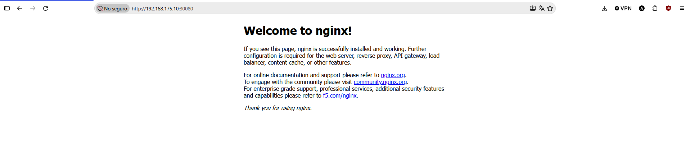
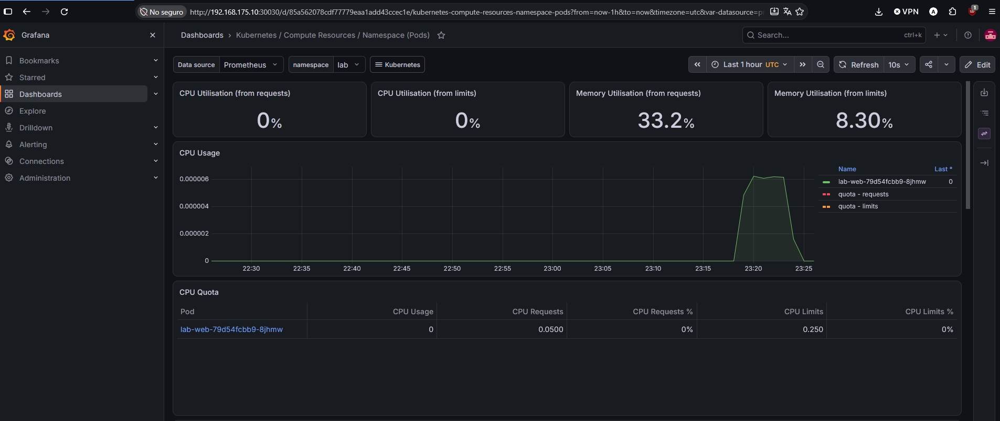
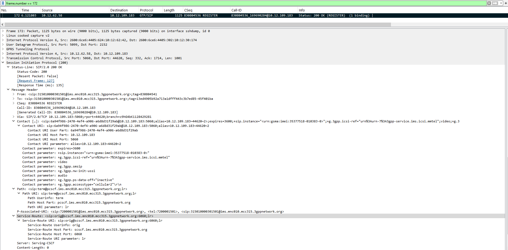
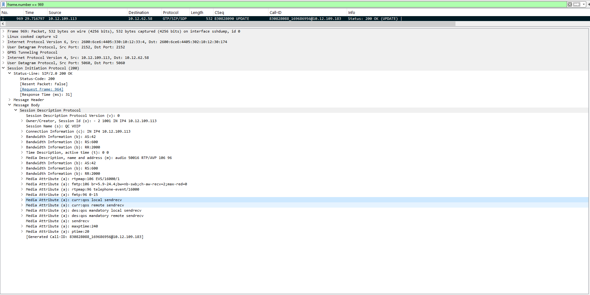
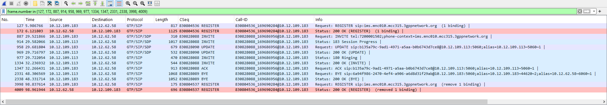

# Caso técnico de Deployment Engineer

Idioma: Español | [English](README.en.md)

Candidato: Agustin Villarauz  
Inicio del laboratorio: 4 de noviembre de 2026  
Estado: implementación del laboratorio y análisis del PCAP documentados. Se incluyen capturas de NGINX, Grafana y Wireshark. Los límites de verificación y reproducibilidad se indican a continuación.

## 1. Objetivo y alcance

Este caso técnico documenta tres tareas:

1. Construir un clúster Kubernetes.
2. Desplegar una aplicación y validar su acceso.
3. Analizar y explicar una captura de tráfico de telecomunicaciones mediante Wireshark.

El reto permite utilizar máquinas virtuales locales. Por ello, la infraestructura se implementó localmente con VMware y K3s.

El análisis del PCAP es independiente del despliegue de Kubernetes. La captura no fue generada por este clúster y el despliegue de una plataforma IMS quedó fuera del alcance de esta implementación. 

## 2. Entorno y arquitectura

### Entorno del host

La configuración reportada del host es:

- Windows 10 Home, build 19045.
- Intel Core i9-9900K.
- 64 GB RAM.
- Dos SSD Samsung 970 EVO, cada uno con aproximadamente 932 GB de capacidad reportada. Estas cifras corresponden a capacidad, no a espacio libre.
- VMware Workstation Pro `26.0.1.25688693`.

Se eligió infraestructura local para evitar reabrir una cuenta de nube con facturación.

El clúster consta de un servidor K3s y un agente. Esta configuración no ofrece alta disponibilidad del plano de control.

### Distribución de nodos y redes

| Nodo | Estado observado | IP interna | IP NAT | Interfaz privada | Subred de pods |
|---|---|---|---|---|---|
| k3s-server-01 | Ready | 192.168.175.10 | 192.168.138.128 | ens34 | 10.42.0.0/24 |
| k3s-worker-01 | Ready | 192.168.175.11 | 192.168.138.131 | ens37 | 10.42.1.0/24 |

```text
Windows host / VMware Workstation Pro
├── VMnet8 NAT: 192.168.138.0/24 — gateway 192.168.138.2
│   ├── server ens33: 192.168.138.128
│   └── worker ens33: 192.168.138.131
└── VMnet1 host-only: 192.168.175.0/24
    ├── server ens34: 192.168.175.10
    └── worker ens37: 192.168.175.11
```

En ambos nodos se registraron las siguientes versiones reportadas:

- Ubuntu `24.04.5 LTS`.
- K3s `v1.37.2+k3s1`.
- Kernel `6.8.0-147-generic`.
- containerd `2.3.7-k3s1`.

Estos valores fueron transcritos de la salida de terminal del laboratorio; no se comprobaron de forma independiente contra los registros de versiones publicados por los proyectos.

La ruta por defecto utiliza `ens33` mediante la red NAT. Las interfaces host-only no tienen puerta de enlace por defecto.

Los parámetros `node-ip` y `flannel-iface` de K3s seleccionan las direcciones e interfaces privadas de los nodos. Se observaron rutas hacia las subredes remotas de pods mediante `flannel.1`. La inspección de rutas no se consideró una prueba activa de conectividad.

## 3. Despliegue de K3s: pasos de implementación y evidencias

El laboratorio se implementó siguiendo esta secuencia:

1. Se crearon dos máquinas virtuales en VMware y se instaló Ubuntu en ambas.

2. Se configuraron dos interfaces de red en cada VM: una interfaz NAT para conectividad de salida y una interfaz host-only para la comunicación privada entre el host y los nodos.

3. Se asignaron las direcciones privadas `192.168.175.10` al servidor y `192.168.175.11` al worker. Se mantuvo la ruta por defecto en la interfaz NAT, sin configurar una puerta de enlace por defecto en las interfaces host-only.

4. Se instaló el servidor K3s en `k3s-server-01`, configurando su dirección privada y seleccionando la interfaz host-only para la red de Flannel.

5. Se instaló el agente K3s en `k3s-worker-01` y se incorporó al servidor, configurando la dirección privada y la interfaz host-only del worker.

6. Se verificó que ambos nodos reportaran `Ready`, se inspeccionaron sus direcciones internas y se revisaron las rutas hacia las subredes remotas de pods. La inspección de rutas no se consideró una prueba activa de conectividad.

7. Se desplegaron NGINX y la plataforma de monitoreo mediante los manifiestos y la configuración de Helm descritos en la sección 4.

8. Se inspeccionaron los nodos, pods, servicios, solicitudes de volumen persistente y la release de monitoreo mediante los comandos de validación de la sección 5.

9. Se accedió a NGINX y Grafana desde el navegador del host Windows mediante sus servicios NodePort. Las capturas se incluyen en la sección 4.

### Registro de implementación y limitaciones

La secuencia anterior resume la implementación realizada. No se recuperaron los comandos históricos exactos de instalación de K3s e incorporación del agente; por ello, esta sección no se presenta como un procedimiento de instalación desde cero probado.

Los archivos de configuración de referencia documentan únicamente parámetros no secretos observados; no constituyen un procedimiento completo de instalación automatizada. No se incluyen tokens de incorporación ni kubeconfig en la entrega.

## 4. Aplicación NGINX y monitoreo

### 4.1. Aplicación NGINX

`lab-web` usa `nginx:stable-alpine`, con una réplica seleccionada en el worker. Solicita 50m CPU y 32Mi RAM; tiene límites de 250m CPU y 128Mi RAM. El servicio NodePort publica el puerto 30080 hacia el puerto HTTP 80. El manifiesto no declara probes ni volúmenes de aplicación.

La aplicación se consultó desde el navegador del host mediante:
`http://192.168.175.10:30080`.




### 4.2. Monitoreo
El release `monitoring` está deployed, revisión 2, chart `kube-prometheus-stack-93.1.1`, App Version reportada `v0.95.1`. Esa App Version no es la versión individual de cada componente.

Grafana: servidor, una réplica, NodePort 30030, PVC 1Gi. Prometheus: worker, una réplica, ClusterIP, PVC 5Gi, scrape/evaluación 30s, retención 24h y límite por tamaño 2GB. Ambos PVC figuran Bound, RWO, local-path. Alertmanager está deshabilitado. Los monitores de controller manager, etcd, kube-proxy y scheduler están deshabilitados en el chart, no los componentes del clúster.

Grafana se consultó desde el navegador del host mediante
`http://192.168.175.10:30030`.




### 4.3. Comandos de despliegue reconstruidos

Los siguientes comandos reflejan la configuración documentada, pero no se probaron nuevamente como una instalación desde cero. Se incluyen como reconstrucción, no como un registro histórico exacto de comandos.

Ejecutar en el servidor después de revisar los manifiestos referenciados:
```bash
sudo kubectl apply -f manifests/lab-web.yaml

helm repo add prometheus-community \
    https://prometheus-community.github.io/helm-charts

helm repo update

sudo helm --kubeconfig /etc/rancher/k3s/k3s.yaml \
  upgrade --install monitoring \
  prometheus-community/kube-prometheus-stack \
  --version 93.1.1 \
  --namespace monitoring \
  --create-namespace \
  -f manifests/monitoring-values.yaml
```

## 5. Validación y acceso

```bash
sudo kubectl get nodes -o wide
sudo kubectl get pods -A -o wide
sudo kubectl get svc -A
sudo kubectl get pvc -A
sudo helm --kubeconfig /etc/rancher/k3s/k3s.yaml list -A
```

Resultado observado: ambos nodos Ready; pods Running con todos sus contenedores preparados. Jobs de instalación Completed se conservan como tales. Hay reinicios históricos; no se atribuye una causa sin evidencia. Se retiró el pod temporal lab-netcheck (BusyBox 1.37, sleep 3600) y se comprobó que lab-web seguía 1/1 Running.

El candidato confirmó acceso desde Windows después del encendido a lab-web y Grafana sin túnel. Direcciones basadas en los NodePort observados:

- Aplicación: `http://192.168.175.10:30080`
- Grafana: `http://192.168.175.10:30030`

Las capturas de acceso a NGINX y Grafana se incluyen en la sección 4. El alcance de la validación se limita a las observaciones documentadas aquí.

No se verificaron métricas específicas de la aplicación NGINX. La presencia de la plataforma de monitorización, por sí sola, no demuestra que exista un exporter de NGINX configurado.

## 6. Análisis IMS / SIP sobre acceso 5G

### 6.1. Contexto y alcance de la captura

La captura analizada forma parte de un conjunto de capturas de tráfico que realicé durante pruebas de evaluación de un core 4G/5G.

Este análisis es independiente del despliegue de Kubernetes: la captura no fue generada por el clúster de este laboratorio.

Los extremos identificados durante el análisis son:

| Función | Dirección IP | Identidad telefónica |
|---|---|---|
| UE-A | 10.12.109.183 | 7200001501 |
| UE-B | 10.12.109.113 | 7200001502 |

La dirección de señalización orientada hacia IMS observada es `10.12.62.58`. Esta dirección no permite, por sí sola, asignar cada función lógica a un servidor físico.

### 6.2. Procedimiento de análisis

El análisis siguió esta secuencia:

1. Identificar el intercambio de registro e inspeccionar los tiempos de validez solicitados y aceptados.
2. Revisar la identidad asociada y las cabeceras de encaminamiento devueltas durante el registro.
3. Aplicar un filtro por Call-ID para aislar la llamada seleccionada.
4. Comparar la oferta y la respuesta SDP, incluidos los códecs y las direcciones de recepción anunciadas.
5. Seguir la respuesta provisional y las actualizaciones de las precondiciones de QoS.
6. Localizar los mensajes de indicación de llamada, aceptación final, confirmación y liberación.
7. Identificar los mensajes de eliminación de la vinculación de registro.
8. Documentar las limitaciones, sin interpretar la señalización como prueba de rendimiento de medios o establecimiento de seguridad.

### 6.3. Topología lógica


Las cajas representan funciones lógicas, no necesariamente servidores físicos distintos. El diagrama diferencia la evidencia observada en el PCAP o en cabeceras SIP de los elementos incluidos como contexto arquitectónico.

```text
UE-A -> gNB-A* -> UPF-A* -> P-CSCF-A -> S-CSCF origen
  -> [encaminamiento IMS interno no reconstruido]
  -> S-CSCF destino* -> P-CSCF-B* -> UPF-B* -> gNB-B* -> UE-B
```

El asterisco (*) identifica una función incluida como contexto arquitectónico, no identificada directamente.

Los nombres `pcscf` y `scscf` de origen aparecen en cabeceras SIP, pero no se han asociado a servidores físicos concretos. Los dos accesos pueden compartir funciones de red.

Las funciones gNB y UPF se incluyen como contexto arquitectónico; sus direcciones no fueron identificadas. No se identificó un tramo EPC/SGW en el análisis.

Las flechas representan una secuencia lógica de señalización, no conexiones físicas directas ni un recorrido de medios RTP validado.

### 6.4. Registro y encaminamiento

La solicitud REGISTER de la trama `127` solicita una validez de registro de `600000` segundos. La respuesta de la trama `172` devuelve un campo `Contact` con `expires=3600`.

La respuesta incluye:

- `P-Associated-URI` con la identidad `7200001501`.
- `Path` con el nombre `pcscf`.
- `Service-Route` con `orig@scscf:6060`.

El INVITE posterior utiliza esa identidad y esa ruta.

La información de `Path` conserva una ruta hacia el contacto registrado, mientras que `Service-Route` informa el encaminamiento de las solicitudes originadas por el terminal.

#### Evidencia del registro



La captura muestra la respuesta al REGISTER de la trama 172 y las cabeceras utilizadas para analizar la validez del registro, la identidad asociada y el encaminamiento.

### 6.5. SDP y precondiciones

UE-A ofrece EVS, AMR-WB, AMR y eventos telefónicos, y anuncia recepción en `10.12.109.183:50030`.

UE-B conserva EVS y `telephone-event`, y anuncia recepción en `10.12.109.113:50016`.

Estas son observaciones del SDP, no una validación de que los medios circularan correctamente entre esas direcciones.

La respuesta `183 Session Progress` requiere `100rel` y `precondition`, e incluye `RSeq: 1`. La correlación exacta con la cabecera `RAck` del PRACK no se comprobó.

La secuencia de precondiciones observada es:

1. Los estados actuales iniciales de QoS local y remoto son `none`.
2. UE-B exige QoS en ambas direcciones y en ambos extremos, y solicita confirmación remota.
3. El UPDATE de la trama `958` informa de estado local `sendrecv` y remoto `none`, desde la perspectiva de UE-A.
4. La respuesta `200 OK` al UPDATE de la trama `969` informa de estados local y remoto `sendrecv`, desde la perspectiva de UE-B.
5. Después aparecen `180 Ringing`, la respuesta final `200 OK` al INVITE, el ACK y el intercambio BYE/200 de liberación.

El `200 OK` al UPDATE confirma esa transacción UPDATE; no constituye la aceptación final del INVITE.

#### Evidencia de las precondiciones de QoS



La captura muestra el SDP de la respuesta al UPDATE en la trama 969, con los estados actuales de QoS local y remoto en `sendrecv`, desde la perspectiva de UE-B. Esto documenta el estado anunciado en la señalización, no una prueba del tráfico RTP.

### 6.6. Paquetes de demostración

Los números de trama corresponden a la captura analizada.

| Trama | Mensaje / aspecto relevante |
|---|---|
| 127 | REGISTER; IPv6 / UDP / GTP-U / IPv4 / TCP / SIP; QFI 1 |
| 172 | 200 OK al REGISTER; Contact expires=3600; identidades asociadas y rutas |
| 887 | INVITE; oferta SDP inicial |
| 914 | 183 Session Progress; EVS y telephone-event; 100rel; precondiciones |
| 958 | UPDATE; el estado local de QoS pasa a sendrecv |
| 969 | 200 OK al UPDATE; estados local y remoto de QoS sendrecv |
| 977 | 180 Ringing |
| 1334, 1347 | 200 OK al INVITE y ACK |
| 2331, 2338 | BYE y 200 OK al BYE |
| 3998, 4009 | Solicitud y aceptación de eliminación de la vinculación de registro |

Filtro de visualización de Wireshark para la llamada seleccionada:

```text
sip.Call-ID == "830828088_169686956@10.12.109.183"
```

Filtro de tramas seleccionadas, incluidos mensajes de registro y de llamada:

```text
frame.number in {127, 172, 887, 914, 958, 969, 977, 1334, 1347, 2331, 2338, 3998, 4009}
```

#### Vista general de los mensajes seleccionados



La lista filtrada reúne los mensajes seleccionados de registro y llamada, permitiendo seguir la secuencia descrita en la tabla anterior. Se muestran paquetes seleccionados, no todos los mensajes de la captura.

### 6.7. Resultados y limitaciones del análisis

La secuencia de señalización seleccionada documenta el registro, la negociación SDP, los cambios de estado de las precondiciones de QoS, la indicación de llamada, la aceptación y la liberación.

Se aplican las siguientes limitaciones:

- No se validaron la entrega RTP, la pérdida de paquetes, el jitter, la reproducción de audio ni los cambios posteriores de códec.
- No se observó un intercambio completo de autenticación IMS-AKA.
- Las propuestas de `Security-Client` no demuestran que se estableciera IPsec.
- El REGISTER seleccionado no presenta ESP visible; esta observación no se generaliza a toda la captura ni a toda la red.
- QFI no es el mismo identificador que 5QI.
- Las observaciones repetidas no se clasifican automáticamente como retransmisiones.
- Los mensajes de liberación de llamada y eliminación de registro se identificaron en la lista de paquetes, pero no se inspeccionaron sus cabeceras completas.

## 7. Limitaciones y mejoras

| Área | Limitación actual | Posible mejora |
|---|---|---|
| Disponibilidad | Un servidor y un host físico; sin alta disponibilidad | Evaluar varios servidores distribuidos entre dominios de fallo distintos |
| Resiliencia de la aplicación | Una réplica de NGINX con ubicación fija | Revisar el número de réplicas y las restricciones de planificación |
| Configuración de la aplicación | Etiqueta de imagen mutable y ausencia de probes explícitas | Fijar la imagen y definir probes apropiadas |
| Persistencia | Almacenamiento local sin pruebas de backup y restauración | Documentar y probar los procedimientos de recuperación |
| Seguridad del transporte | Acceso HTTP de laboratorio sin validación de TLS ni endurecimiento | Añadir y validar los controles de seguridad apropiados |
| Pruebas de recuperación | Se comprobó el acceso después del encendido, pero no una recuperación integral ante fallos | Definir y ejecutar casos de prueba de recuperación |
| Reproducibilidad | Registro incompleto de los comandos históricos de instalación y de los recursos finales de las VM | Documentar un procedimiento de instalación probado y los recursos definitivos |

No se evaluó el estado de soporte y seguridad del host.

## 8. Limpieza opcional — destructiva

No ejecutar durante la demostración. Eliminar la aplicación con `sudo kubectl delete -f manifests/lab-web.yaml` también elimina el namespace definido en ese archivo y puede afectar otros recursos dentro de lab. Desinstalar monitoring requiere revisar antes datos, PVC y política de retención; no se propone eliminación automática de volúmenes. Conservar evidencias y backups antes de limpiar.

## Referencias técnicas

- SIP: RFC 3261.
- Offer/Answer: RFC 3264.
- Respuestas provisionales fiables: RFC 3262.
- UPDATE y precondiciones: RFC 3311, RFC 3312.
- Rutas: RFC 3327 y RFC 3608.
- Identidades asociadas: RFC 7315.
